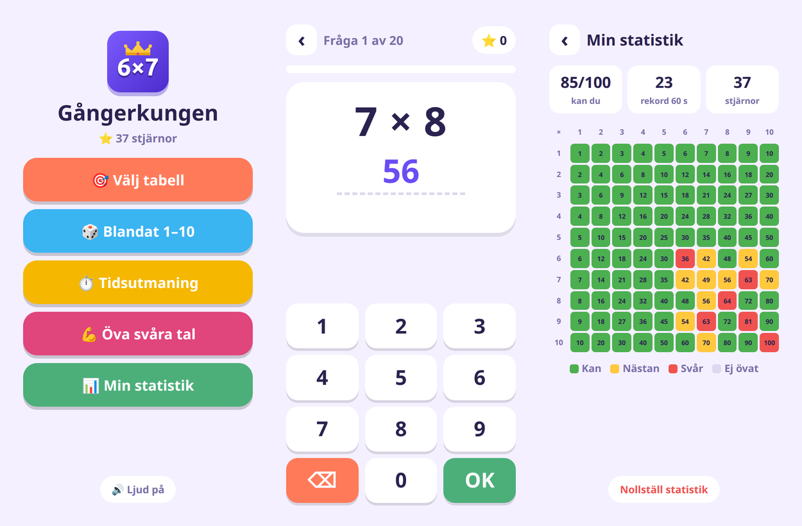

# 👑 Gångerkungen

Ett roligt sätt för barn att träna **multiplikationstabellerna 1–10**. Gångerkungen är en webbapp som man installerar på mobilen och som fungerar utan internet.

**▶️ Öppna appen: https://perkarom.github.io/gangertabell/**



## Så tränar man

| Läge | Vad händer |
|---|---|
| 🎯 **Välj tabell** | Öva på en eller flera tabeller, t.ex. bara 7:an, eller 6:an och 8:an. |
| 🎲 **Blandat 1–10** | 20 frågor från hela gångertabellen. |
| ⏱️ **Tidsutmaning** | Så många rätt som möjligt på 60 sekunder. Försök slå ditt rekord! |
| 💪 **Öva svåra tal** | Tal du ofta svarar fel på eller tänker länge på kommer oftare. |
| 📊 **Min statistik** | Hela tabellen i färg: grönt = kan, gult = nästan, rött = svår. |

- Stora sifferknappar direkt på skärmen, så att mobilens tangentbord inte täcker frågan.
- Svarar man fel visas rätt svar, och samma fråga kommer tillbaka lite senare i omgången.
- 1–3 stjärnor per omgång, konfetti vid perfekt resultat och nytt rekord.
- Ljud kan slås av och på, och appen följer mobilens mörka läge.

## Installera på mobilen

**Android (Chrome)**
1. Öppna länken ovan i **Chrome**.
2. Tryck på **Installera appen** på startsidan, eller **⋮ → Installera app**.

**iPhone/iPad (Safari)**
1. Öppna länken i **Safari**.
2. Tryck på **Dela** ⬆︎ → **Lägg till på hemskärmen**.

Appen hamnar på hemskärmen som **6×7**, startar i helskärm och fungerar utan internet. Uppdateringar hämtas automatiskt när appen öppnas med internet.

> På iPhone hörs inget ljud om ringknappen på sidan står på ljudlöst.

## Så fungerar "Öva svåra tal"

Varje tal får en vikt utifrån de **5 senaste svaren** på just det talet:

- grundvikt 1, **+3 per fel**, **−0,4 per rätt**, **+2** om man i snitt svarar långsammare än 6 sekunder
- tal man aldrig övat på får vikt 2, och lägsta vikten är 0,3

Svar från **alla lägen** räknas, och **7×8 och 8×7 räknas som samma tal**. Svarar man rätt 5 gånger i rad på ett tal kommer det sällan igen. Ett nytt fel gör att det kommer oftare igen.

## Spara och hämta statistik

Under **Min statistik** finns **💾 Spara statistik** och **📥 Hämta statistik**. Spara skapar en liten fil (`gangerkungen-statistik-ÅÅÅÅ-MM-DD.json`) som du kan lägga i Filer, Google Drive eller skicka till dig själv. Hämta läser in filen igen och ersätter statistiken som finns i appen.

Spara statistiken innan du tar bort appen eller byter telefon. På iPhone raderas statistiken när appen tas bort från hemskärmen.

## Integritet

All statistik sparas bara på enheten (`localStorage`), och en sparad statistikfil hamnar där du själv väljer. Appen skickar ingen data någonstans och har inga konton, ingen reklam och ingen spårning.

## Teknik

Vanlig HTML, CSS och JavaScript. Inga ramverk och inget byggsteg.

| Fil | Innehåll |
|---|---|
| `index.html` | Alla vyer (start, välj tabell, övning, resultat, statistik) |
| `style.css` | Utseende, ljust och mörkt läge |
| `app.js` | Spellogik, statistik, ljud (Web Audio) och installationsknapp |
| `sw.js` | Service worker: hämtar från nätet först och använder cachen när man är offline |
| `manifest.webmanifest` | Appnamn, ikoner och helskärmsläge |
| `icons/` | Appikoner (vanlig, maskable och iOS) |

### Köra lokalt

```bash
python3 -m http.server 8080
# öppna http://localhost:8080
```

### Testa logiken

Funktionerna som skapar frågor och räknar statistik kan köras direkt i Node:

```bash
node -e 'const L = require("./app.js"); console.log(L.buildRound(L.combos([7])))'
```

### Publicera en ny version

Appen publiceras med GitHub Pages från grenen `main`. Höj versionen i `CACHE` i `sw.js` när du ändrar något, och pusha. Då hämtar installerade appar den nya versionen nästa gång de öppnas med internet.
